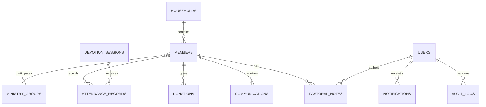

# Data model

The schema preserves the supplied prototype's entities while normalizing relationships for PostgreSQL.

## Core tables

- `users`: authenticated staff with `admin`, `staff`, or `pastor` roles.
- `households`: shared family address and contact context.
- `members`: member identity, contact, membership, care, and lifecycle fields.
- `ministry_groups` and `ministry_group_member`: ministry metadata and many-to-many participation.
- `devotion_sessions`: dated QR-enabled attendance windows.
- `attendance_records`: member or guest participation. A unique session/member key prevents duplicate member check-ins.
- `donations`: amount, currency, fund, method, status, and receipt data.
- `communications`: inbound/outbound contact history.
- `pastoral_notes`: confidential care notes and follow-up tracking.
- `dashboard_metrics`: optional dated reporting snapshots for trend warehousing; live dashboard cards are calculated from source records.
- `notifications`: staff alerts and actions.
- `audit_logs`: immutable-style event snapshots for create, update, and delete operations.

Current dashboard cards are calculated from source records to prevent stale totals. The supplied snapshot entity is retained as `dashboard_metrics` for historical reporting and future scheduled aggregation.
